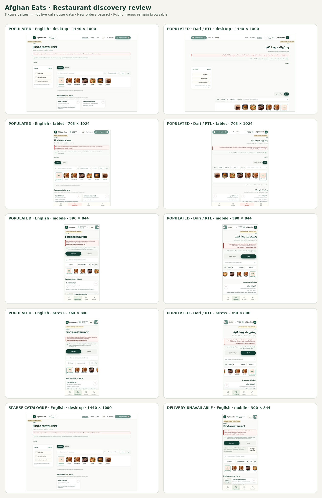

# Afghan Eats restaurant discovery — review frames

**Review-only:** These browser captures use named Playwright fixture data, not the live restaurant catalogue. Each frame includes the capture-only badge **“REVIEW FIXTURE · NOT LIVE DATA”**; that badge is not part of the website UI. Ordering remains paused, while public menu browsing stays available.

## Populated catalogue fixtures

| Language | Desktop | Tablet | Mobile | 360 px stress test |
|---|---|---|---|---|
| English | [1440 × 1000](restaurant-discovery-review-fixture-en-desktop-1440x1000.png) | [768 × 1024](restaurant-discovery-review-fixture-en-tablet-768x1024.png) | [390 × 844](restaurant-discovery-review-fixture-en-mobile-390x844.png) | [360 × 800](restaurant-discovery-review-fixture-en-stress-360x800.png) |
| Dari (RTL) | [1440 × 1000](restaurant-discovery-review-fixture-fa-desktop-1440x1000.png) | [768 × 1024](restaurant-discovery-review-fixture-fa-tablet-768x1024.png) | [390 × 844](restaurant-discovery-review-fixture-fa-mobile-390x844.png) | [360 × 800](restaurant-discovery-review-fixture-fa-stress-360x800.png) |

## Distinct catalogue states

- **Sparse catalogue:** [English desktop, 1440 × 1000](restaurant-discovery-review-fixture-sparse-en-desktop-1440x1000.png), with one restaurant and unsupported rating/delivery values withheld.
- **Delivery unavailable at the entered address:** [English mobile, 390 × 844](restaurant-discovery-review-fixture-unavailable-address-en-mobile-390x844.png). The delivery notice is distinct from the browsing-area label, and a public restaurant/menu listing remains visible.

## Data and regression notes

- [Dynamic-field mapping](restaurant-discovery-data-field-map.md) explains which catalogue, quote, and verified-location fields are allowed to appear.
- [Customer journey regression tests](../tests/customer-journey.spec.js) include bilingual viewport checks, mobile overflow checks, and the named fixture captures.
- [Ordering-pause regression tests](../tests/ordering-pause.spec.js) preserve the paused-ordering / public-menu-browsing distinction.
- The organization page was not changed: Herat service area, `support@afghaneats.net`, replies within three business days, and the multi-location caveat remain intact.

No editable Figma source was supplied for this review; these PNGs are browser captures, not editable design frames.
